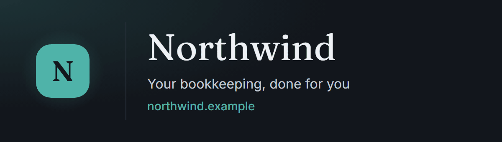

# Animated email signature: a Claude skill

Give Claude your website, and it builds an animated email signature from it: a small looping GIF that shows your business doing its job, plus a page where your team types their name and copies a ready-to-paste signature for Gmail, Outlook or Apple Mail.



*Example for a made-up bookkeeping brand. It opens and ends on the brand card, so mail apps that show only the first frame still get a finished signature.*

## Install

Using the [skills CLI](https://github.com/vercel-labs/skills):

```bash
npx skills add him4318/animated-email-signature
```

Or copy this folder by hand into your skills folder:

- For all your projects: `~/.claude/skills/animated-email-signature/`
- For one project: `<project>/.claude/skills/animated-email-signature/`

Then ask Claude Code something like:

> Make an animated email signature for https://my-site.com and a page for my team to copy it.

## What it does

1. **Reads your site.** It looks at your pages, logo, colours, fonts and product images, with screenshots it can look at itself.
2. **Picks a scene that fits.** There are three:
   - a customer question answered step by step, for software, apps and services
   - a real figure counting up, for scale or impact
   - a few of your own product photos, for shops, food and portfolios
3. **Writes a short story from your site's own words** and shows you the plan. Nothing is rendered until you say OK.
4. **Renders and checks the GIF.** It's 1200×340, shown at 480×136, under 1 MB, with no text cut off and a seamless loop.
5. **Builds the team page and helps you deploy it.** The page is kept out of search engines. If you can't put files on your site, it suggests other places to host the GIF.

## Needs

- Node.js 18 or newer
- ffmpeg:
  - macOS: `brew install ffmpeg`
  - Windows: `winget install Gyan.FFmpeg`
  - Linux: `sudo apt install ffmpeg`
- Network access, to read your site and load Google Fonts

Claude installs Playwright (a headless browser) in a work folder the first time it runs.

## Good to know

- **Animated GIF is the only motion that works across mail apps.** Some mail apps, such as older desktop Outlook, show only the first frame. That's why the first frame is always a finished card.
- **The signature loads the GIF from its web address every time an email is opened.** So keep the file at the same address. To change it later, replace the file in place.
- **Paste the signature into Gmail, Outlook or Apple Mail once after deploying,** and send yourself a test email.

## About

Made by the team behind [Qelvra](https://qelvra.in), an AI SEO and AEO agent that reads your whole site and does the SEO work for you.

MIT licensed.
